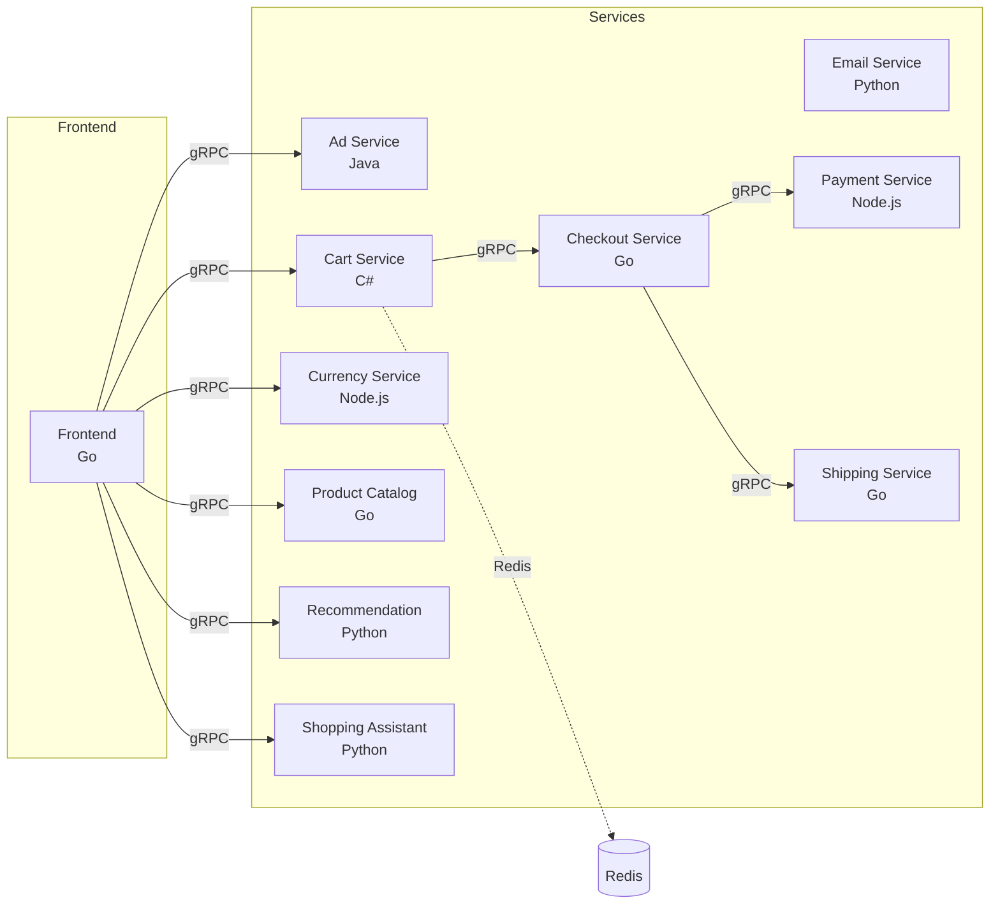

<p align="center">
  
</p>

<h1 align="center">Online Boutique</h1>

<p align="center">
  A cloud-native e-commerce demo built as <b>11 polyglot microservices</b>
  communicating over <b>gRPC</b> — ready to deploy on <b>AWS EKS</b> or spin up
  locally with <b>Docker Compose</b>.
</p>

<p align="center">
  <a href="https://go.dev"></a>
  <a href="https://nodejs.org"></a>
  <a href="https://python.org"></a>
  <a href="https://openjdk.org"></a>
  <a href="https://dotnet.microsoft.com"></a>
  <a href="https://grpc.io"></a>
  <a href="https://docs.docker.com/compose/"></a>
  <a href="https://aws.amazon.com/eks/"></a>
</p>

---

## What is this?

**Online Boutique** is a working e-commerce storefront where users can browse products, manage a cart, and place orders from start to finish. It demonstrates a production-grade polyglot microservice architecture.

## Architecture



## Quick Start

```bash
git clone https://github.com/grlokesh96/Online-Boutique.git
cd Online-Boutique
docker compose up --build
```

Open http://localhost:8080

## Technology Stack

- **Languages**: Go, Node.js, Python, Java, C#
- **Communication**: gRPC + Protocol Buffers
- **Data**: Redis (cart), in-memory catalog
- **Observability**: OpenTelemetry ready
- **Deployment**: Docker, Kubernetes, AWS EKS, Argo CD

## Project Structure

```
src/                  # 11 microservices
k8s/                  # Kubernetes manifests
protos/               # Shared .proto definitions
docs/                 # Architecture diagrams
```

## Contributing

See [CONTRIBUTING.md](CONTRIBUTING.md) for guidelines.

## License

This project is licensed under the Apache License 2.0 — see the [LICENSE](LICENSE) file.

---

*Maintained as an enterprise-grade reference implementation for cloud-native microservices.*
